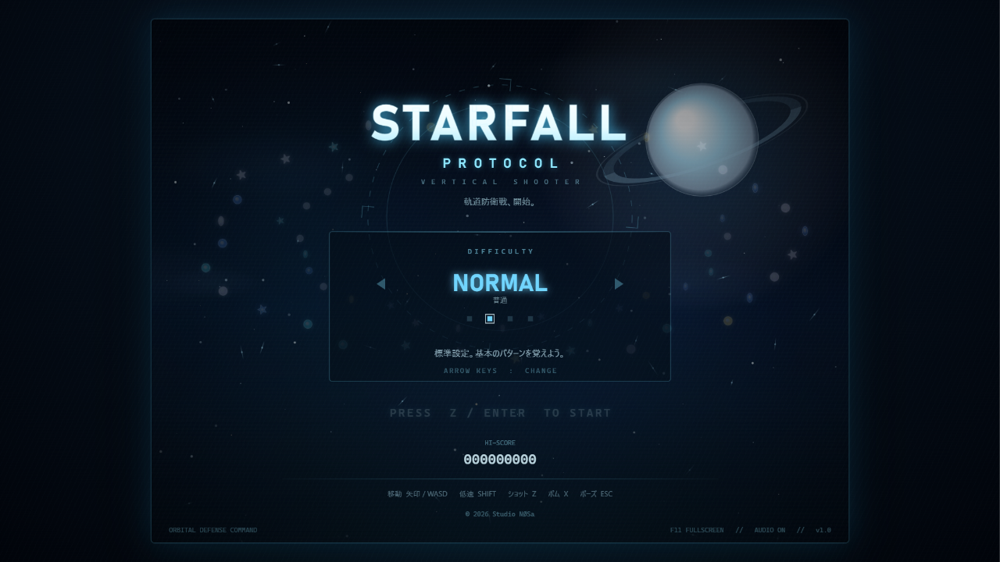
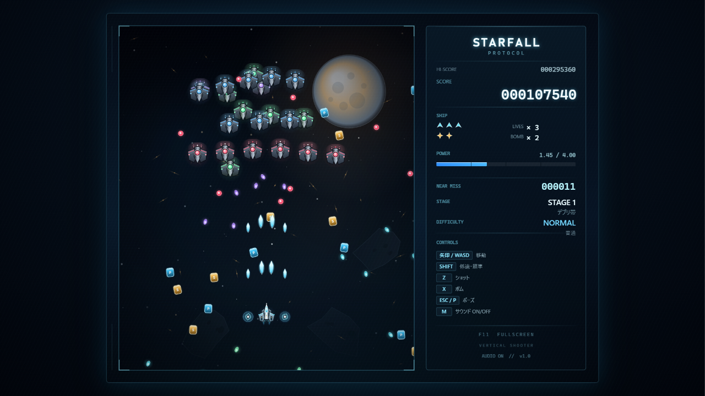
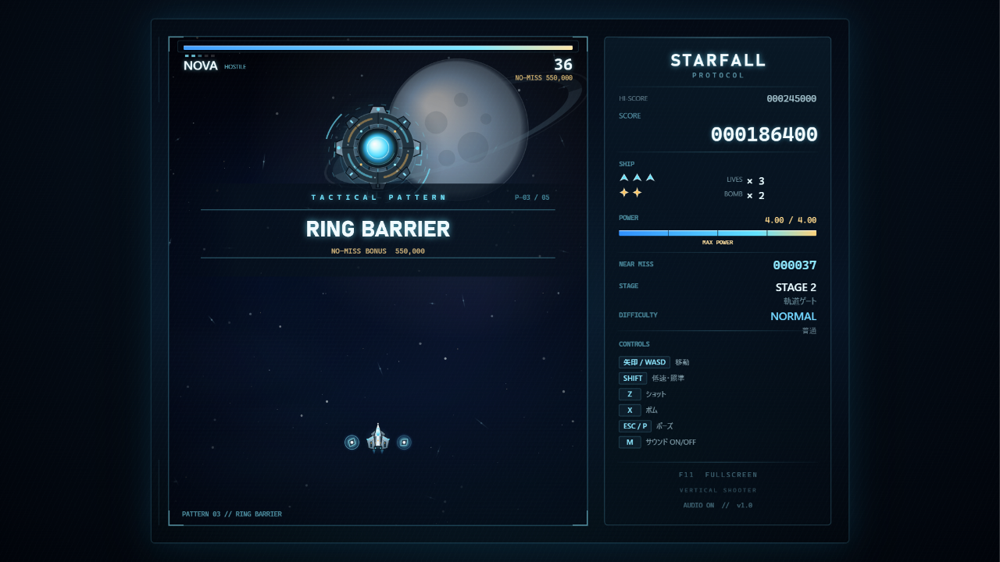

# STARFALL PROTOCOL

**A self-contained sci-fi vertical-scrolling bullet-hell shooter.**  
Ships, backgrounds, bullets, effects, and sound effects are generated in code. The six BGM tracks are original compositions by Studio NØSa.

軌道防衛軍の迎撃機を操る、オリジナルSF縦スクロールシューティングです。Windows向けのデスクトップアプリ（Electron）としてビルドできます。画像・効果音はコード生成、BGMはStudio NØSa作曲のオリジナル6曲です。

**Created by Studio NØSa**







## 特長

- **2エリア構成**: デブリ帯と軌道ゲート。各エリアに護衛艦（中ボス）と主力艦（ボス）が待ち受けます。
- **手触りのよいスウォーム戦闘**: 小型敵は一撃で撃破可能。撃ち続けても画面が空かないよう、編隊が継続的に補充されます。
- **タクティカルパターン**: ボス戦は名前付きの攻撃パターンで進行します。
- **ノーミスボーナス**: 攻撃パターンを被弾・ボムなしで突破すると、残り時間に応じたボーナスを獲得。
- **ニアミス**: 敵弾の近くをかすめるとスコアが入り、HUDの `NEAR MISS` が増加します。
- **4段階の難易度**: EASY / NORMAL / HARD / LUNATIC。LUNATICは道中・ボスともに大きく強化され、ボスは回転する隙間付きリングを追加で放ちます。
- **プロシージャル生成**: 自機、ドローン、ボス艦、背景、弾、エフェクト、効果音をコードで生成。BGMはStudio NØSa作曲のオリジナル楽曲を使用しています。
- **ローカル保存**: ハイスコアや難易度設定はアプリ内のローカルストレージに保存されます。外部送信はありません。

## プレイ方法

### Windows版

[最新版をダウンロード（GitHub Releases）](https://github.com/Keychrom/STARFALL-PROTOCOL/releases/latest)

配布用のWindowsポータブル版は `npm run dist` で生成できます。ビルド済み版はGitHub Releasesで配布しています。

```bash
npm ci
npm run dist
```

`dist/STARFALL-PROTOCOL-1.0.1.exe` が生成されます。リポジトリにはビルド成果物を含めていないため、配布する場合はこのEXEをGitHub Releasesに添付してください。

- インストール不要のポータブル実行ファイルです。
- 初回起動に数秒かかる場合があります。
- 署名なしの実行ファイルのため、Windows SmartScreenの警告が出たら「詳細情報」→「実行」を選んでください。
- `F11` でフルスクリーン切り替えができます。

### ソースから起動

必要なもの: Node.js 22.12以降、npm。

```bash
npm ci
npm start
```

`npm run smoke` は起動確認用のスモークテストです。Electronのウィンドウを開き、スクリーンショットを保存して終了します。

### ブラウザで遊ぶ

`index.html` を直接ブラウザで開くか、任意の静的HTTPサーバーでこのフォルダを配信してください。Chrome / Edge / Firefoxを推奨します。

- ブラウザの自動再生制限により、サウンドは最初のキー入力から有効になります。
- `F11` フルスクリーンなど、一部の機能はElectronアプリ版のみです。

## 操作

| キー | 動作 |
| --- | --- |
| 矢印キー / `WASD` | 移動 |
| `Shift` | 低速移動・照準表示 |
| `Z`（押しっぱなし） | ショット |
| `X` | ボム |
| `Esc` / `P` | ポーズ |
| `M` | サウンド ON / OFF |
| `F11` | フルスクリーン（アプリ版） |
| `Z` / `Enter` | 決定・開始 |

- タイトル画面で ← / → を押すと難易度を変更できます。
- ポーズ中は `R` でエリアリトライ、`Q` でタイトルへ。
- ゲームオーバー時は `Z` / `Enter` でコンティニュー、`Esc` でタイトルへ。

## ゲーム内容

### 難易度

| 難易度 | 内容 | 残機 | ボム |
| --- | --- | --- | --- |
| EASY | 敵弾が少なめ。入門向け。 | 4 | 3 |
| NORMAL | 標準設定。基本のパターンを覚えよう。 | 3 | 2 |
| HARD | 敵弾の密度と速度が上昇。 | 3 | 2 |
| LUNATIC | 最高難度。道中・ボスともに大幅に強化。 | 2 | 2 |

LUNATICでは弾数・弾速・ボスHP・敵の出現数が大きく増え、ボスは既存パターンに加えて回転する隙間付きリングを追加射撃します。

### ボス

| エリア | 中ボス | ボス |
| --- | --- | --- |
| 1. デブリ帯 | WATCHER-01（護衛駆逐艦） | AEGIS（重巡航艦） |
| 2. 軌道ゲート | GATEKEEPER（軌道防衛ユニット） | NOVA（軌道コア） |

### BGM

| 使用箇所 | 曲名 |
| --- | --- |
| タイトル | ORBITAL BRIEFING |
| エリア1 デブリ帯 | DEBRIS SWARM |
| 中ボス〜ボス1 | AEGIS HEAVY ASSAULT |
| エリア2 軌道ゲート（中ボス含む） | GATE APPROACH |
| 最終ボス | NOVA FINAL ORBIT |
| クリア／エンディング | PROTOCOL COMPLETE |

作曲: **Studio NØSa**  
音源: `audio/bgm/`（クレジット: [`audio/bgm/CREDITS.md`](audio/bgm/CREDITS.md)）

### スコア

- 敵撃破、ボスへのダメージ、ニアミスでスコアが入ります。
- 敵が落とす `P` チップでパワーが上がり、ショット数と威力が増加します（最大4.00）。
- `S` チップを取るとスコアが加算されます。近づくと自動で吸い寄せられます。
- ノーミスボーナスは残り時間に比例します。安全に抜けられるなら早めに攻め切るのが高得点のコツです。
- 全2エリアクリアでミッション完了。最終スコア、ニアミス数、パーフェクト回数、ミス数、コンティニュー数からランクが決まります。

### 攻略のヒント

- `Shift` を押すと移動が遅くなり、自機中央に照準が表示されます。敵弾が濃いところは低速で抜けましょう。
- 当たり判定は見た目よりかなり小さめです。照準の中心だけを意識すると避けやすくなります。
- ニアミスはリスクを取るほど伸びますが、被弾するとパワーが下がりノーミスも失います。ボムはここぞというときに。
- パワーが高いほどショット本数が増えます。序盤はPチップを優先して回収しましょう。

## 技術構成

- **HTML5 Canvas 2D** 描画。内部解像度960×720、1.5倍スーパーサンプリング。
- **Web Audio API** による効果音のリアルタイム合成と、Studio NØSa作曲のBGM 6曲（MP3）の再生。
- **Electron 44** によるデスクトップアプリ化。レンダラーはサンドボックス化し、CSPを設定しています。
- 弾はオブジェクトプールで管理し、大量の弾幕でも安定して動作するよう調整。
- 外部ライブラリはElectron本体とビルドツールのみ。画像と効果音はプロシージャル生成、BGMは本プロジェクトのオリジナル音源です。
- ハイスコア・難易度・音量設定はローカル保存。外部サーバーへの送信はありません。

## プロジェクト構成

```text
STARFALL-PROTOCOL/
├─ index.html                エントリーポイント
├─ css/
│  └─ style.css              ページの外観
├─ js/
│  ├─ util.js                定数・数学・難易度・UIカラー
│  ├─ input.js               キーボード入力
│  ├─ audio.js               BGM再生 / SFX合成
│  ├─ sprites.js             自機・ドローン・ボス・弾・アイテムの描画生成
│  ├─ background.js          宇宙背景（星・惑星・デブリ・塵）
│  ├─ bullets.js             敵弾プール・自機弾・アイテム・パーティクル
│  ├─ patterns.js            リング・扇弾・スパイラルなどの弾配置ヘルパー
│  ├─ player.js              自機・ショット・ボム・被弾処理
│  ├─ enemies.js             敵ドローンの挙動とウェーブ生成
│  ├─ boss.js                ボス／中ボスのフェーズ管理と照準リング
│  ├─ stages.js              2エリアのタイムラインとボス攻撃パターン
│  └─ game.js                状態遷移・HUD・スコア・各画面
├─ audio/
│  └─ bgm/                   BGM 6曲（MP3）とクレジット
├─ electron/
│  └─ main.js                Electronメイン処理・ウィンドウ生成
├─ build/
│  ├─ icon.ico               アプリアイコン
│  └─ icon.png
├─ docs/
│  └─ screenshots/           スクリーンショット
├─ tools/
│  └─ make_icon.py           アイコン生成スクリプト（任意）
├─ package.json              アプリ設定・ビルド設定
├─ package-lock.json
├─ LICENSE
└─ README.md
```

`node_modules/` と `dist/` は生成物のためリポジトリに含めていません。

## カスタマイズ

- 難易度・弾数倍率: `js/util.js` の `DIFFICULTIES`
- 敵の配置: `js/stages.js` の `STAGES[].events`
- ボスの攻撃: `js/stages.js` の各フェーズ `pattern()`
- BGM: `js/audio.js` の `TRACKS`（音源は `audio/bgm/`）
- 配色: `js/util.js` のUIカラー、`js/sprites.js`、`js/background.js`
- アプリ名・ビルド設定: `package.json`

アイコンを再生成する場合（任意）:

```bash
python -m pip install pillow
python tools/make_icon.py
```

## 開発

バグ報告や改善提案はIssues / Pull Requestsへお願いします。ゲーム内容・バランス・UI・BGMなど、小さな改善も歓迎です。

## ライセンス・クレジット

- 制作・著作: **Studio NØSa**
- コード、画像・効果音、BGMは **MIT License** です。詳細は [LICENSE](LICENSE) を参照してください。
- タイトル、キャラクター、艦船、ステージ、BGMは本プロジェクトのオリジナルです。BGMの作曲・著作はStudio NØSaです。
- 外部の画像素材や既存作品の素材は使用していません。
- 本作は特定の既存作品・企業とは関係のないオリジナル作品です。

---

**STARFALL PROTOCOL** — a vertical scrolling shooter.  
© 2026 Studio NØSa
